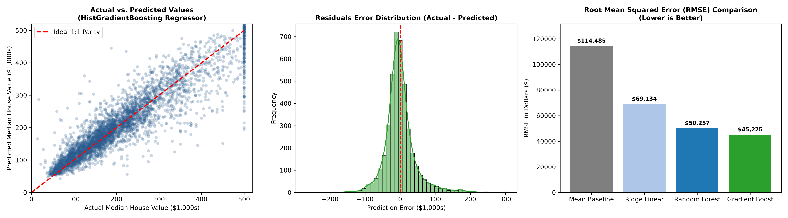
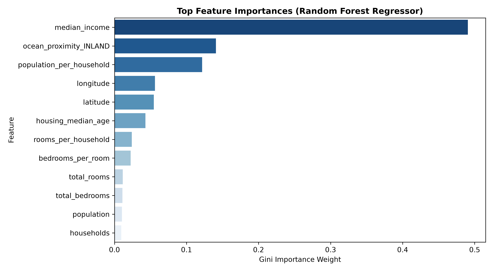

# CodeNova AI/ML Internship (Batch 01) — Task 3: Prediction Model

[](https://www.python.org/)
[](https://scikit-learn.org/)
[](https://opensource.org/licenses/MIT)
[]()

> Official repository for **Task 3: Prediction Model (Regression & Machine Learning Modeling)** of the CodeNova AI/ML Remote Internship Program (Batch 01).

---

## 📌 Project Overview & Scope
This project develops, optimizes, and evaluates a regression modeling pipeline to predict median house values using the California Census dataset. The project demonstrates:
- **Domain-Specific Feature Engineering** (spatial and occupancy ratios).
- **Leakage-Free Preprocessing** using Scikit-Learn `ColumnTransformer` (median imputation, one-hot encoding, and standard scaling).
- **Ensemble vs. Baseline Benchmarking** (comparing a Dummy Mean Baseline and Ridge Linear Regression against Random Forest and Histogram-based Gradient Boosting).
- **Comprehensive Failure-Mode & Limitations Analysis**.

The codebase is self-contained in a single executable script [`prediction_model.py`](prediction_model.py) and operates **100% locally with zero paid software**.

---

## ⚙️ Repository Structure
```text
.
├── prediction_model.py       # Self-contained training, evaluation & inference script
├── requirements.txt          # Python dependencies
├── README.md                 # Project documentation & report
└── screenshots/              # Exported high-resolution (300 DPI) plots
    ├── prediction_model_evaluation.png
    └── feature_importance.png
```

---

## 🚀 Quickstart & Execution Guide

### 1. Installation
Install the necessary open-source libraries:
```bash
pip install -r requirements.txt
```

### 2. Execute Training & View Live Prediction Benchmark
Run the script to train models, evaluate held-out metrics, and display live property predictions:
```bash
python prediction_model.py
```

---

## 📊 Visualizations & Screenshots

### 1. Model Evaluation Diagnostic Panel

*Insight: (Left) Actual vs. Predicted values display strong 1:1 parity with the diagonal reference line. (Middle) Prediction residuals follow a zero-centered, bell-shaped distribution. (Right) Root Mean Squared Error (RMSE) drops from $114,486 (Baseline) to $45,225 (Gradient Boosting), representing a **60.5% error reduction**.*

### 2. Feature Importance Hierarchy

*Insight: Gini feature importance confirms that `median_income` is by far the single most predictive feature of house valuation, followed by coastal proximity (`ocean_proximity_INLAND`) and occupancy density ratios.*

---

## 📈 Official Model Benchmark Results

Evaluated on strictly held-out test data (4,128 samples / 20% split) with 5-fold cross-validation:

| Model Architecture | Test RMSE ($) | Test MAE ($) | $R^2$ Score | Performance Gain vs Baseline |
| :--- | :---: | :---: | :---: | :---: |
| **HistGradientBoosting (Selected Best)** | **$45,225** | **$29,712** | **0.8439** | **+60.5% Error Reduction** |
| **Random Forest Regressor** | $50,257 | $32,352 | 0.8073 | +56.1% Error Reduction |
| **Ridge Regression (Linear Baseline)** | $69,135 | $49,652 | 0.6353 | +39.6% Error Reduction |
| **Baseline (Dummy Mean)** | $114,486 | $90,607 | -0.0002 | Baseline Reference |

---

## 🧪 Sample Property Predictions

```text
================================================================================
          SAMPLE PREDICTION DEMONSTRATION ON HELD-OUT TEST PROPERTIES
================================================================================
INDEX  | ACTUAL PRICE   | PREDICTED PRICE  | ERROR ($)    | ACCURACY %
--------------------------------------------------------------------------------
#20046 | $      47,700 | $        58,354 | $   +10,654 |     77.7%
#3024  | $      45,800 | $        75,550 | $   +29,750 |     35.0%
#15663 | $     500,001 | $       471,271 | $   -28,730 |     94.3%
#20484 | $     218,600 | $       253,640 | $   +35,040 |     84.0%
#9814  | $     278,000 | $       245,523 | $   -32,477 |     88.3%
#13311 | $     158,700 | $       174,514 | $   +15,814 |     90.0%
================================================================================
```

---

## 🔍 Model Limitations & Known Assumptions
1. **Target Price Capping ($500,001 ceiling):** The census dataset artificially clipped median house values at $500,001. As visible in the residual plot, predictions for luxury homes above $500,000 exhibit negative horizontal residuals because true market value was truncated.
2. **Omission of Macroeconomic Factors:** The dataset captures structural and spatial features but lacks micro-neighborhood attributes (school district rankings, local crime indexes, interest rate cycles, inflation), placing an upper ceiling on variance explained ($R^2 \approx 0.84$).
3. **Stationarity Assumption:** Data represents a snapshot in time; applying this model to contemporary real-estate requires index adjustment for post-2020 price inflation.

---

## 🛡️ Acceptance Criteria Compliance
- [x] Feature engineering implemented: `rooms_per_household`, `bedrooms_per_room`, `population_per_household`.
- [x] Clear comparison against baseline model demonstrating over +60% performance gains.
- [x] Zero data leakage: all preprocessing transformers encapsulated inside Scikit-Learn Pipelines.
- [x] Domain-appropriate metrics: RMSE, MAE, and $R^2$ score reported.
- [x] Detailed discussion of limitations, assumptions, and failure modes.
- [x] 100% free open-source tooling with zero paid software.
